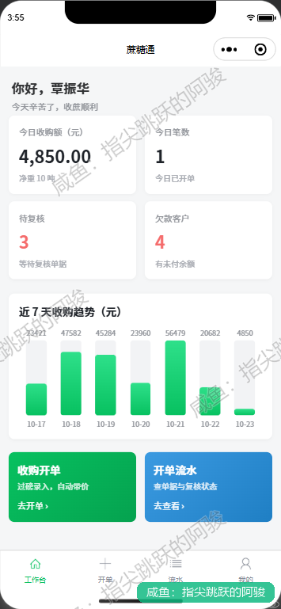
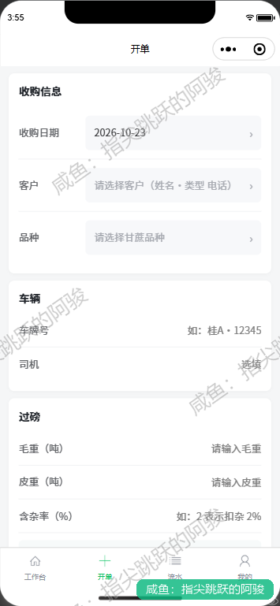
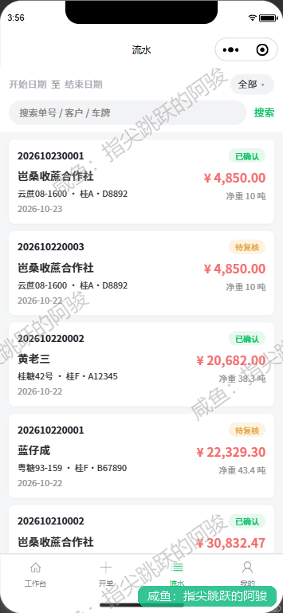
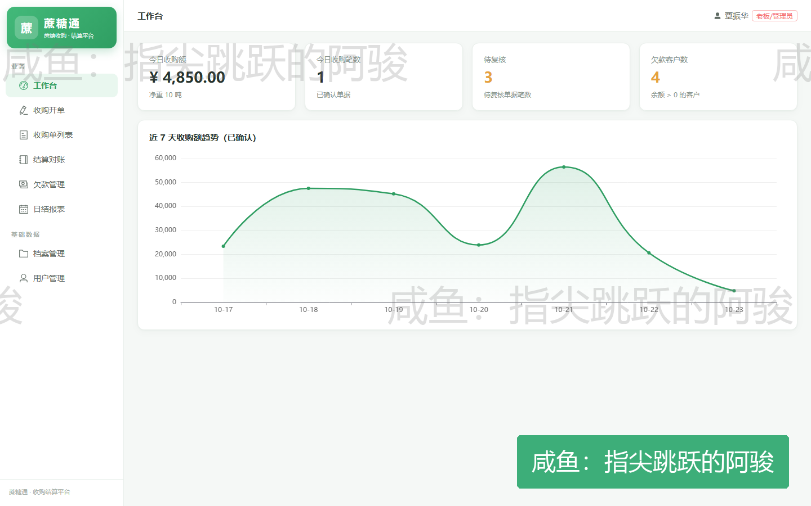
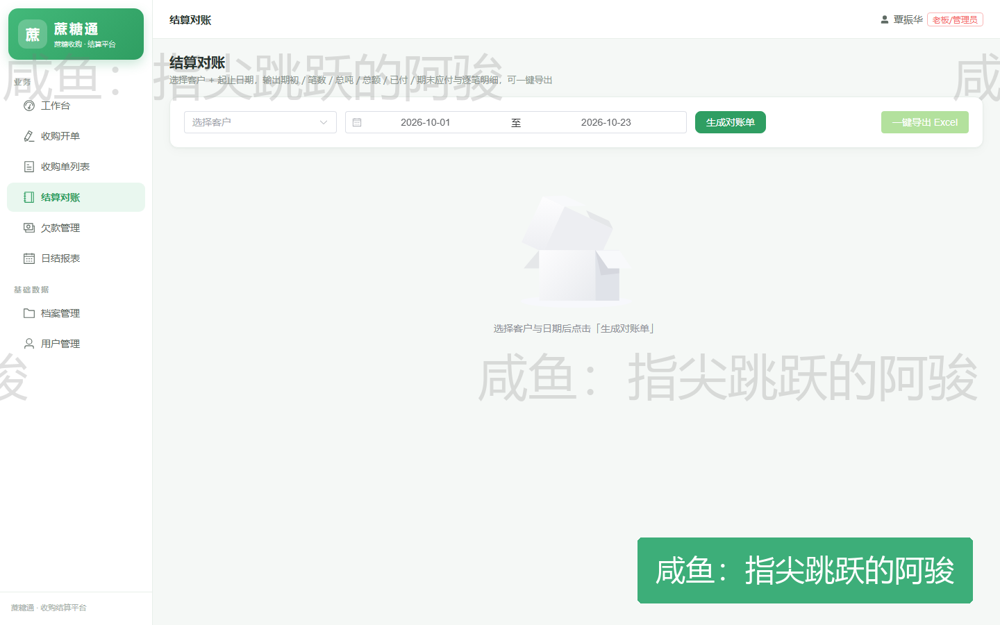
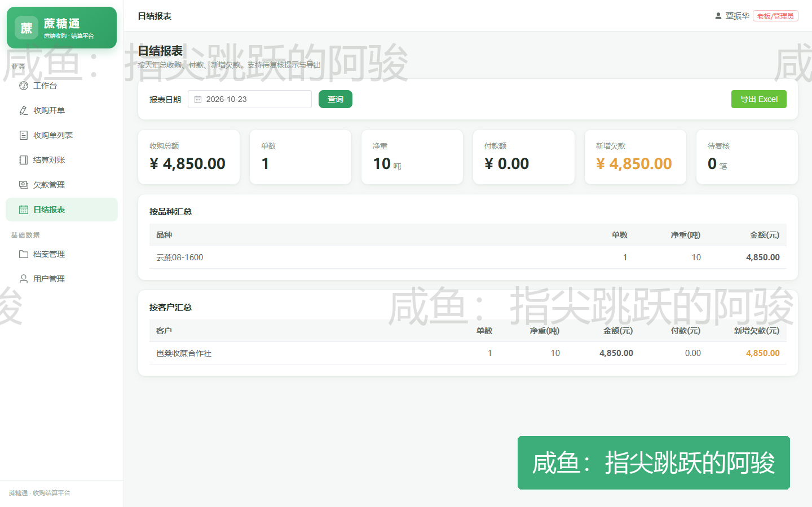

# 蔗糖通 · 甘蔗收购开单记账系统

> 面向糖料蔗收购站的一体化记账系统：小程序开单 + PC 管理后台 + Spring Boot 后端，围绕「收购 → 结算 → 欠款 → 日结」设计，榨季收蔗账目当天算清。

## 界面预览

**小程序端（收购站开单）**

| 登录 | 开单 | 流水 |
|---|---|---|
|  |  |  |

**PC 管理后台**

| 工作台 | 结算对账 | 日结报表 |
|---|---|---|
|  |  |  |

## 解决什么问题

糖料蔗收购的特点：**按吨计价、运费扣杂、榨季集中结算**。

- 收购站现场开单 → 小程序按「毛重/皮重 → 自动算净重与金额」开单，蔗农一键带出
- 结算对账 → 按蔗农维度聚合收购单，榨季结算一笔笔对得清
- 欠款管理 → 预付款/赊账分开记，余额不足自动提醒
- 日结报表 → 当日收购量、金额、车数自动汇总，支持 Excel 导出

## 技术架构

```
miniapp（uni-app + Vue3 + TS）    收购站现场开单
admin（Vue3 + Element Plus）      老板/会计对账结算
        │                            │
        └──────────┬─────────────────┘
                   ▼
server（Spring Boot 3 + MyBatis-Plus + JWT）
                   │
                   ▼
              MySQL（sql/zhetangtong.sql 一键建库）
```

| 模块 | 技术栈 | 说明 |
|---|---|---|
| `miniapp` | uni-app、Vue 3、TypeScript、Vite | 微信小程序端：开单 / 流水 / 我的 |
| `admin` | Vue 3、Element Plus、Pinia、ECharts | PC 管理后台：工作台 / 收购开单 / 收购单列表 / 结算对账 / 欠款 / 日结 / 档案 / 用户 |
| `server` | Spring Boot、MyBatis-Plus、JWT、MySQL | 单体后端，`ZTT_*` 环境变量覆盖配置，本地与云上一套代码 |
| `deploy` | Docker Compose、Nginx | 云端一键部署：MySQL + 后端 + 前端静态托管 |
| `sql` | MySQL | 建库脚本 + 演示数据 |

## 快速开始

```bash
# 1. 数据库
mysql -uroot -p < sql/zhetangtong.sql

# 2. 后端（默认连 localhost:3306/zhetangtong，账号 root/123456，可用 ZTT_* 环境变量覆盖）
cd server && mvn spring-boot:run

# 3. PC 管理后台
cd admin && npm install && npm run dev

# 4. 小程序（HBuilderX 或 CLI）
cd miniapp && npm install && npm run dev:mp-weixin
```

## 说明

- 仓库内数据均为**演示数据**（蔗农、手机号皆为虚构），不含任何真实客户信息
- 项目由本人独立完成（需求、设计、前后端开发、部署）
